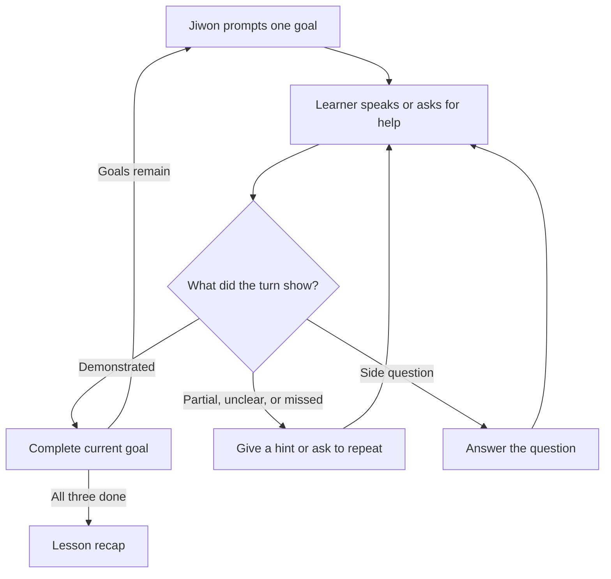

# Guided Voice Lesson Implementation Plan

> **For agentic workers** Use `superpowers:subagent-driven-development` or `superpowers:executing-plans` when executing the approved plan. Track work with the checkboxes below.

**Goal** Turn the page after **Start lesson** into a one-on-one Korean practice call. Han Jiwon appears waist-up and guides the learner through three goals they complete by speaking.

**Architecture** Keep the existing lesson URL and split the room into framing, call state, and lesson state. A server owns assessment and keeps progress in memory for the current call. The browser submits one clip per push-to-speak turn and drives Jiwon’s mouth from the audio she actually plays.

**Tech stack** React, TypeScript, React Router, Vite, Three.js, VRM, browser audio APIs, and a Node.js API. Proposed provider split is Inworld for speech recognition, OpenAI for assessment and teaching replies, and ElevenLabs for Jiwon’s voice.

## First playable lesson

Use the existing `/tutors/vita/lesson?level=<level>` route. The tutor label and controls should feel like a video call. Frame Jiwon from around the waist up with room above her hair. Keep her in view throughout the lesson. Put the objective list beside the call and below it on narrow screens. Keep the captions, mic toggle, sound toggle, and **End lesson**. Treat the call as a live avatar view. Request microphone access only when the learner enables it.

| Objective | What counts as demonstrating it | Example of help after an attempt |
| --- | --- | --- |
| Greet Jiwon in Korean | An appropriate Korean greeting for starting a lesson, such as 안녕하세요 or 안녕하십니까 | “Try the polite greeting you would use when meeting someone.” |
| Say your name in Korean | A Korean self-introduction with a name. Accept valid alternatives, including 저는 민지예요 and 제 이름은 민지입니다 | “You gave your name. Try putting it into a Korean introduction.” |
| Ask Jiwon’s name in Korean | A Korean question asking the tutor’s name, such as 이름이 뭐예요? or 성함이 어떻게 되세요? | “You’ve said hello. Now ask what my name is.” |

Each level works toward the same goals. `beginner` starts with a short English instruction and assumes zero Korean. `basic` asks for a polite greeting from memory, with English scaffolding. `comfortable` opens with a short Korean role-play prompt and brief English context. Feedback adapts to each attempt. If the learner needs repeated help, change the explanation or rehearse a smaller piece. When the learner asks for the phrase or says they are starting from zero, Jiwon can model it and explain it in English. An immediate echo counts as practice. Follow it with a fresh prompt that lets the learner recall the phrase before checking off the goal.

Use English aloud for guidance, feedback, and answers to English questions. Say the Korean practice phrases aloud as part of the same reply. With captions on, show the English guidance and relevant Hangul with a short meaning when useful. A purely technical message can be English-only. A beginner can hear the explanation and the Korean example with captions off.

Show **0 of 3 completed** on entry. Highlight the current objective. Check it off only after the learner demonstrates it in a valid spoken turn. The first release assesses what the learner said and the language they used. It makes no pronunciation score from the transcript. If an answer includes several goals, assess the current one and use the remainder as conversational context. Prompt for the next goal separately.

## User flows

1. **Enter the call.** The level link or a valid direct URL opens the lesson with the chosen level. Missing or invalid levels use the existing beginner default. Show the opening prompt as soon as it is available. Attempt playback after entry and show **Play tutor audio** if the browser blocks it. Starting or refreshing opens a fresh session.
2. **Take a turn.** **Turn on mic** enables the microphone control. During the learner’s turn, hold **Push to speak** to capture and release to submit one clip. Use the same gesture with Space or Enter while the control has focus. Show **Your turn**, **Recording**, **Processing**, or **Jiwon is speaking** as appropriate. Waiting and thinking trigger no capture, upload, transcription, or learner-turn inference. Muting or canceling during recording discards the unsent clip.
3. **Demonstrate the goal or retry.** Jiwon acknowledges a correct answer, updates progress, and gives one prompt for the next goal. For a partial or incorrect answer, she acknowledges what worked when applicable, gives one specific hint, and asks for another attempt at the same goal. **Need a hint?** can request the same short guidance without recording. Silence or ambiguous transcription leads to “I didn’t catch that. Could you try again?” and keeps the goal active.
4. **Ask a side question.** If the learner asks “How do I say that politely?”, Jiwon answers in English, says the relevant Korean wording aloud, and invites them to try the current goal again. That turn leaves progress where it was, even if the question quotes the right Korean phrase. The learner can ask in English, answer in Korean, or use both languages in a turn.
5. **Finish or leave early.** Three demonstrated goals trigger a short spoken wrap-up and an on-screen recap of what was demonstrated, what took help, and one thing to practise next. **End lesson** immediately stops capture and playback and shows a recap of confirmed progress, including when no goals were completed. From the recap, return to the picker with Jiwon selected. **Back** leads to level selection and preserves the chosen level. It asks before discarding an active recording or confirmed progress.
6. **Open a roster preview.** The other tutors retain their existing roster and level pages. A direct lesson link shows a preview with a return path and a link to Jiwon’s Korean lesson. Preview routes request no microphone or paid provider calls.



## Gaps and decisions

| Priority | Scenario and why it matters | Proposed decision |
| --- | --- | --- |
| Critical | The current page has no microphone capture or server. A toggle or model-generated claim could currently be mistaken for learning progress. | Use one server-owned session per visit. Only accept evidence for the active goal from a usable final spoken transcript, using the goal rubric and a grounded quote from that turn. Reject duplicate or stale turns. |
| Critical | Capture or playback can survive navigation. Provider credentials and raw learner audio need a defined boundary. | Keep provider keys on the server. Stop microphone tracks, audio, and outstanding client requests on exit. Store the active session and evidence in memory with expiry. Keep audio only for processing or an explicit in-room retry. Exclude audio and transcript content from application logs. |
| Important | Mic permission can be denied, the first audio can be blocked, and Korean names or English interruptions may be misheard. | Keep the room usable with the last prompt and a way to retry permission or playback. Ask learners to repeat or confirm ambiguous captures aloud. Test Korean and English turns with the actual providers before the live demo. |
| Important | A reply can fail at three points. Re-submitting everything after a TTS failure can double-count an answer. | Retry a failed capture/evaluation under the same turn ID. Save the accepted evaluation and reply text before synthesizing speech. If voice alone fails, keep the result visible and retry only playback or synthesis. |
| Important | Waiting for input in an open voice stream can generate unnecessary provider usage and misread thinking pauses. | Capture only while holding **Push to speak**. Release submits one clip. Jiwon decides whether the clip demonstrates the active goal. |
| Minor | Captions or sound can both be disabled, and browser navigation can interrupt a tutorial reply. | Default captions and sound on and the mic off. Keep the current goal and short feedback available in the agenda even with captions off. A direct reload starts over. |

### Decisions for the hackathon demo

1. **Learner controls capture, Jiwon assesses the goal.** A push-to-speak clip gives Jiwon one attempt to evaluate. The agenda advances automatically after a demonstrated objective.
2. **One run for the judges.** Keep the active goals, attempts, and recap in memory. Refreshing or re-entering starts at zero. The demo needs no learner account, lesson history, or database.
3. **English as the bridge to spoken Korean.** Jiwon explains in English and speaks the Korean wording being practised. The learner can ask for a translation, meaning, or politeness explanation at any point.

Before the live demo, verify actual provider access and test English questions, short Korean responses, and mixed-language turns.

## File map

| Path | Responsibility |
| --- | --- |
| `language-tutor/src/pages/LessonPage.tsx` | Tutor and level route, call layout, preview state, recap, and navigation |
| `language-tutor/src/pages/LessonPage.css` | Call frame, captions, responsive layout, and controls |
| `language-tutor/src/components/TutorAvatar.tsx`, `language-tutor/src/components/VrmAvatar.tsx`, `language-tutor/src/components/createVrmMotion.ts` | Call-only framing, idle animation, and playback-driven mouth movement |
| `language-tutor/src/lesson/lesson-contract.ts` | Goals, level IDs, and shared API types |
| `language-tutor/src/lesson/useLessonSession.ts`, `language-tutor/src/lesson/useLearnerAudio.ts`, `language-tutor/src/lesson/useTutorAudio.ts` | Session requests, mic capture, and tutor playback respectively |
| `language-tutor/server/lesson/session.ts`, `language-tutor/server/lesson/session.test.ts` | Pure progress bookkeeping and deterministic tests |
| `language-tutor/server/lesson/handler.ts`, `language-tutor/server/lesson/providers.ts`, `language-tutor/server/lesson/handler.test.ts` | API/session ownership, provider calls, and injected-provider integration tests |
| `language-tutor/server/index.ts`, `language-tutor/vite.config.ts`, `language-tutor/package.json`, `language-tutor/README.md`, `AGENTS.md` | HTTP entry point, local proxy, executable checks, setup, and verified prototype baseline |

## Implementation tasks

### 1. Build the call layout and waist-up view

- [ ] In `LessonPage.tsx`, keep the existing tutor route, replace fixture-driven progress markup with an agenda that renders `current`, `upcoming`, or `complete`, and remove the clickable objective buttons and **Next step**. Give the goal and media status independent text. Keep the four lesson controls visible at 390px and 1440px viewport widths.
- [ ] In `TutorAvatar.tsx` and `VrmAvatar.tsx`, add a `framing?: 'call'` prop. For the call, compute the camera aim and distance from the normalized head and hips once the model loads, and re-fit on resize. Start with a vertical crop from slightly below hip height to just over the model’s top bound. Widen the fit when the room is narrow enough to crop both shoulders. Use an explicit audio value for speech, independent of frame size or label. Continue using the existing camera for the full-body picker.
- [ ] In `LessonPage.css`, give the video surface a dark, understated background and reserve caption space above the controls. The camera or avatar fallback occupies the same box. Keep the call controls reachable while the objective list scrolls on mobile.
- [ ] Run `cd language-tutor` and `npm run build`. Expect TypeScript and Vite to pass. Open Jiwon’s lesson on desktop and mobile, including with WebGL disabled. Verify face, shoulders and waist stay framed, controls stay visible, and the full-body picker preview still works. Commit this slice as `feat: frame Jiwon for the lesson call` during implementation.

### 2. Make spoken evidence the only way to advance

- [ ] In `lesson-contract.ts`, define the goal order and response contract below. Define the level IDs once and have the existing `data/levels.ts` labels satisfy that type. Use the selected level for the opening, then evaluate each response against the current goal.

```ts
export const goalIds = ['greet', 'introduce-name', 'ask-name'] as const;
export type GoalId = (typeof goalIds)[number];
export const levelIds = ['beginner', 'basic', 'comfortable'] as const;
export type LevelId = (typeof levelIds)[number];
export type Outcome =
  | { kind: 'demonstrated'; evidence: string }
  | { kind: 'retry'; gap: string }
  | { kind: 'side-question' }
  | { kind: 'unclear' };
export type TutorReply = {
  spokenText: string; // English guidance with any Korean examples in speaking order
  englishText: string;
  koreanText: string | null;
};
export type GoalEvidence = { goal: GoalId; turnId: string; quote: string; hadHelp: boolean };
export type SessionView = {
  activeGoal: GoalId | null;
  completed: GoalEvidence[];
  helpByGoal: Partial<Record<GoalId, string>>;
  reply: TutorReply;
  audioPath: string | null;
};
```

- [ ] Write deterministic cases in `server/lesson/session.test.ts` before the reducer. Cover evidence from an alternative valid greeting, an unrelated English sentence, a blank or uncertain transcript, a hint request, a side question, duplicate submission, old goal, tutor-supplied wording without a fresh learner attempt, and final completion. A test with a fake successful evaluation should still fail when its evidence quote is absent from the learner’s transcript.

```ts
import assert from 'node:assert/strict';
import { test } from 'node:test';
import { evaluateProgress } from './session.ts';

const greeting = {
  id: 'turn-1',
  goal: 'greet',
  source: 'speech',
  transcript: '안녕하십니까',
  usableTranscript: true,
  hadHelp: false,
} as const;

test('accepts evidence from the learner’s Korean greeting', () => {
  const outcome = { kind: 'demonstrated', evidence: '안녕하십니까' } as const;
  const completed = evaluateProgress([], greeting, outcome);
  assert.deepEqual(completed, [
    { goal: 'greet', turnId: 'turn-1', quote: '안녕하십니까', hadHelp: false },
  ]);
  assert.equal(evaluateProgress(completed, greeting, outcome), completed);
});

test('a claimed quote cannot substitute for the learner’s words', () => {
  const outcome = { kind: 'demonstrated', evidence: '안녕하세요' } as const;
  assert.deepEqual(evaluateProgress([], greeting, outcome), []);
});

test('answering a politeness question leaves the objective in place', () => {
  const question = { ...greeting, transcript: 'How do I say that politely?' };
  assert.deepEqual(evaluateProgress([], question, { kind: 'side-question' }), []);
});
```
- [ ] Implement `session.ts` around the following transition. Normalize Unicode and whitespace for the quote comparison. Store processed turn IDs and replies in the in-memory session. The transition leaves progression unchanged on side questions, hints, unclear text, and early exit. Keep a short reason for help in the active session so the recap can refer to it.

```ts
import { goalIds, type GoalEvidence, type GoalId, type Outcome } from '../../src/lesson/lesson-contract.ts';

export function evaluateProgress(
  completed: readonly GoalEvidence[],
  turn: {
    id: string;
    goal: GoalId;
    source: 'speech' | 'hint';
    transcript: string;
    usableTranscript: boolean;
    hadHelp: boolean;
  },
  outcome: Outcome,
): readonly GoalEvidence[] {
  const expectedGoal = goalIds[completed.length];
  if (
    !expectedGoal || turn.goal !== expectedGoal || turn.source !== 'speech' ||
    !turn.usableTranscript || outcome.kind !== 'demonstrated' ||
    completed.some((item) => item.turnId === turn.id)
  ) return completed;

  const normalize = (text: string) => text.normalize('NFC').trim().replace(/\s+/gu, ' ');
  const quote = normalize(outcome.evidence);
  if (!quote || !normalize(turn.transcript).includes(quote)) return completed;
  return [...completed, { goal: expectedGoal, turnId: turn.id, quote, hadHelp: turn.hadHelp }];
}
```

  Use the model verdict only after applying the current objective rubric, checking that the input is an attempted answer, and handling assisted echo or unclear input. The evidence substring guard grounds the verdict and cannot decide whether the Korean phrasing is correct on its own.
- [ ] Add `"test:lesson": "node --experimental-strip-types --test server/lesson/session.test.ts"` under `scripts` in `package.json` and append `server/lesson/handler.test.ts` when adding that file. Use explicit `.ts` import paths in server modules. Run `npm run test:lesson` with Node 22 before creating the reducer and expect a missing-module error. Run it again after adding the reducer and expect all deterministic cases to pass. Run `npm run build`. Commit this slice as `feat: track lesson goals from spoken evidence`.

### 3. Connect the server and three providers

- [ ] In `handler.test.ts`, inject fake recognizer, evaluator, and synthesizer. Verify that missing sessions and invalid audio are rejected, duplicate IDs replay the same result, concurrent submissions cannot advance twice, and ending the lesson makes any in-flight result ineligible to change progress.
- [ ] In `handler.ts`, mount same-origin routes under `/api/lesson`. Give each active session an opaque server-generated ID bound to an HttpOnly same-site browser cookie. Use a 30-minute idle expiry for the MVP. Allow one in-flight turn per session, reject stale objectives, and cap audio size and capture duration. Recheck session state and objective before applying any late response. Resolve retries by existing turn ID before checking the current goal so a retried accepted turn can return its cached result after the agenda advanced.

  | Request | Contract |
  | --- | --- |
  | `POST /api/lesson/sessions` | Body `{ tutorId, level, entryId }`. Accept only Jiwon and a known level. Return `{ sessionId, view }` with opening prompt. Reuse the session for the same entry ID and browser. |
  | `POST /api/lesson/sessions/:id/turns` | Multipart fields `turnId`, `goalId`, `kind`; audio file only for `kind=speech`. A `kind=hint` turn never advances the goal. Return `SessionView`. |
  | `GET /api/lesson/sessions/:id/audio/:replyId` | Synthesize or replay the stored reply for this session. Return audio bytes with their content type. Retry of audio alone leaves the evaluation unchanged. |
  | `POST /api/lesson/sessions/:id/end` | Close the session, cancel in-flight work, and return the final confirmed progress and help notes. Repeated calls return the same recap while the session record exists. |

- [ ] In `providers.ts`, transcribe one submitted clip with Inworld and send the usable transcript and scoped objective rubric to an OpenAI structured response. Start with automatic language detection and avoid forcing a Korean-only hint that could degrade English questions. The assessment returns a validated `Outcome` and draft bilingual feedback. Select the next prompt server-side only after a valid transition. Synthesize the English guidance and Korean examples together using the approved `spokenText` and a multilingual ElevenLabs voice. Return a repeat prompt for silence or ambiguous captures. Ignore any voice-profile metadata. Set request timeouts, map failed stages to retryable room states, and read provider keys and the selected ElevenLabs voice from server environment variables.
- [ ] In `server/index.ts`, mount the handler on `127.0.0.1:8787` for local development. Add `"dev:lesson": "node --experimental-strip-types --env-file-if-exists=.env.lesson.local server/index.ts"` in `package.json`. Configure Vite’s `server.proxy` entry as `'/api/lesson': 'http://127.0.0.1:8787'`. Start `npm run dev:lesson` and `npm run dev` in separate terminals from `language-tutor/`. Keep the server env file ignored by Git. Serve the built app and API from the same origin for the demo so session cookies and audio playback stay on that origin.
- [ ] Test actual provider access with a short Korean answer, a personal name, a polite side question in English, and a mixed-language turn. Verify the browser’s chosen recording format reaches Inworld. Start with WebM where supported and use MP4 where the recorder and transcription endpoint both support it. Measure submit-to-first-audio time with a stopwatch or browser timing and record it before deciding whether to add streaming. Use credentialed local smoke tests alongside `npm run test:lesson` and `npm run build`. Commit as `feat: connect lesson speech and assessment providers`.

### 4. Connect the call controls and audio-driven face

- [ ] In `useLearnerAudio.ts`, request permission on **Turn on mic** and stop the permission-check stream as soon as it resolves. The toggle arms **Push to speak**. Acquire a fresh stream when the learner holds the control and start recording only if they are still holding it. Handle pointer down and release with pointer capture, plus focused Space or Enter keydown and keyup. Ignore repeated keydown. Submit once on release and stop all audio tracks. Cancel the clip on pointer cancellation, focus loss, mute, or exit. At 30 seconds, stop and submit once even if still held. If a permission or capture request finishes after release or cancellation, stop the late stream and discard it. Show a retry action for denied or interrupted capture and preserve the prompt.
- [ ] In `useLessonSession.ts`, build the room state around `waiting`, `recording`, `processing`, `playing`, and `ended`. Reflect server-confirmed results only. Keep a failed clip in memory for explicit retry of the same turn. Do not show a network failure as a wrong answer. Abort fetches on exit and ignore responses for an ended or superseded session. Prevent Strict Mode or double clicks from starting two usable sessions or submitting one answer twice.
- [ ] In `useTutorAudio.ts`, play from one audio element and use an analyser connected to the same output to drive mouth openness while audible. Hand a current amplitude ref to `VrmAvatar.tsx`, which passes it to `createVrmMotion.ts` on each frame. Set openness to zero on mute, pause, end, error, or route exit. Use `playing` to label tutor speech and keep the mic from recording tutor audio. Allow **Play tutor audio** when autoplay is blocked and let the learner read the prompt and speak while sound is off. Captions show English guidance and relevant Hangul. The captions toggle controls visibility independently of playback and progress.
- [ ] With provider fakes, verify the mic stays off initially, keystrokes or double clicks cannot start overlapping recordings, captions can be toggled, and an accepted answer survives failed TTS. In a Chromium browser with a microphone, watch Jiwon’s mouth during playback, then mute, pause, and end the lesson. Expect the mouth to close each time. Run `npm run test:lesson` and `npm run build` before committing as `feat: wire the lesson room to live voice turns`.

### 5. Complete the recap and preview flows

- [ ] Build the recap from `completed` and `helpByGoal` in `LessonPage.tsx`. For finished lessons, Jiwon gives a short spoken recap as the screen shows the three goals. For manual exit, stop audio immediately and show confirmed progress. If connectivity prevents fetching the closing snapshot, use the last acknowledged progress. Make **Back to tutors** return to `/?tutor=vita`. Keep the level return link at `/tutors/vita/level?level=<level>`.
- [ ] Render a preview for all other tutor lesson URLs and skip session creation entirely for those routes. Run through the call as a beginner, cover the early exit with zero and one goal, refresh and verify a fresh lesson, run the other tutor route, and confirm no microphone or provider request is made there.
- [ ] Update `README.md` and `AGENTS.md` after verifying the finished demo. Describe server environment setup, how to run the app and tests, provider roles, and exercised flows. Commit as `feat: recap completed speaking goals`.

## End-to-end acceptance

Run from `language-tutor/`. `npm run test:lesson` covers the transition and failed-provider cases. `npm run build` checks the production bundle. The browser pass uses a licensed Jiwon VRM and test provider credentials.

| Walkthrough | Expected result |
| --- | --- |
| Pick Jiwon and start at each level | The opening changes with level. Jiwon fits waist-up while the agenda begins at zero. |
| Enable the mic, wait, then hold and release **Push to speak** | Waiting produces no audio capture or learner-turn requests. One release submits one clip. |
| Say a valid greeting, introduce yourself, and ask Jiwon’s name | Each distinct answer checks off its current objective and the final one leads to a recap. |
| Ask in English how to greet someone, then try it in Korean | Hear English coaching and a spoken Korean example. An English question leaves progress unchanged. A later demonstrated Korean answer advances the goal. |
| Refresh during an active lesson | A fresh session opens at zero without loading prior progress. |
| Deny the mic. Retry. Send silence. Disconnect mid-turn. | The same objective remains active and the interface offers a way to recover. |
| Toggle captions, mute tutor audio mid-reply, then end while recording | Captions can be controlled independently, the mouth follows audible playback, and ending stops the microphone and audio. |
| Open another tutor’s direct lesson link | The roster preview appears with a route to the Korean lesson. |

### Judges’ walkthrough

1. Choose Jiwon and **New to it**, then enable the mic. Jiwon opens with the first goal in English.
2. Hold **Push to speak** and ask “How do I say hello politely?” Release and hear Jiwon explain in English and say 안녕하세요. The agenda still shows **0 of 3**.
3. On Jiwon’s next prompt, greet her in Korean. Continue with your name, such as 제 이름은 제레미예요, then ask hers with 이름이 뭐예요? Use a separate turn for each goal. Ask for English help if needed.
4. Show the final **3 of 3** recap and the note that you asked for help with the greeting.

## Future tutor-controlled whiteboard

After verifying the voice lesson, plan this as a separate addition. Jiwon can open a board, add a short Korean phrase or contrast, and close it when the explanation ends. For example, she could show 이름 next to the more honorific 성함 in response to a politeness question. Render a narrow, validated set of board actions such as `open`, `write`, and `close`, with plain Hangul and an optional gloss. Keep the mic, captions, and current objective available while the board is open. Closing it returns to the same speaking prompt. Board actions leave progress unchanged. Decide its layout and learner dismissal behavior when planning that feature.

## Provider references

- [Inworld synchronous transcription and browser audio formats](https://docs.inworld.ai/api-reference/sttAPI/speechtotext/transcribe)
- [OpenAI Structured Outputs](https://developers.openai.com/api/docs/guides/structured-outputs)
- [ElevenLabs text-to-speech language support](https://elevenlabs.io/docs/overview/capabilities/text-to-speech)
